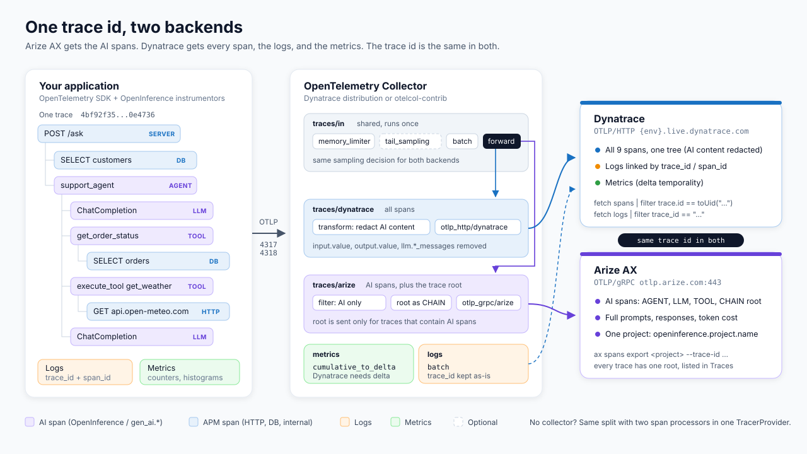
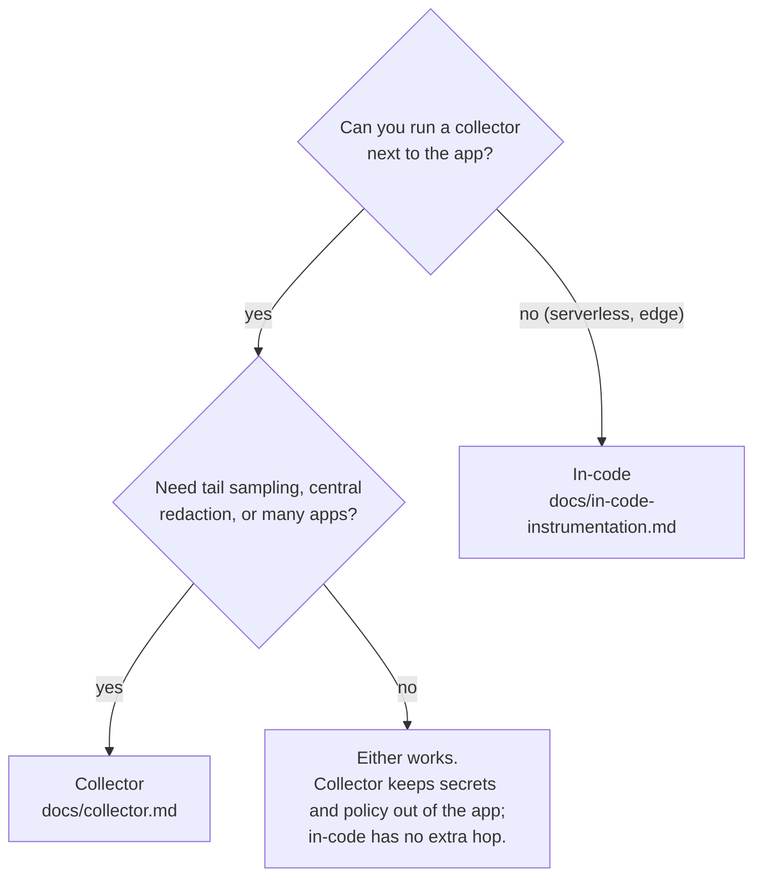

# Arize AX and Dynatrace with OpenTelemetry: one trace id, two backends

This kit shows how to send telemetry to Arize AX and Dynatrace at the same time, with the same trace id in both:

- Arize AX gets the AI spans (agents, LLM calls, tools, retrievers) with full prompts and responses, for evaluation and debugging. Every trace has a root, so it appears in the Arize Traces view.
- Dynatrace gets every span (HTTP, database, internal, and the AI spans without their prompt content), the logs, and the metrics.

When an answer looks wrong in Arize, search Dynatrace for its trace id to see the database queries, outbound calls, and logs of that request.

This is the sample code for the Arize AX cookbook [Send telemetry to Arize AX and Dynatrace](https://arize.com/docs/ax/cookbooks/instrument/send-telemetry-to-arize-and-dynatrace).



## Guides

- [Collector](docs/collector.md): the app exports to one OTLP endpoint, and an OpenTelemetry Collector filters, redacts, and fans out to both backends.
- [In-code](docs/in-code-instrumentation.md): no collector. One `TracerProvider` with two span processors, in Python and TypeScript.
- [Testing](TESTING.md): what `scripts/verify.py` checks against the real backends, and how to run it.

## Which approach



| | Collector | In-code |
| --- | --- | --- |
| App needs Arize and Dynatrace credentials | No | Yes |
| Filtering and redaction | Collector config (OTTL) | Span processors in code |
| Tail sampling | Yes | No (head sampling only) |
| Delta metrics for Dynatrace | `cumulative_to_delta` processor | SDK exporter setting |
| Root span in Arize | The trace's root span is sent as a CHAIN | The top AI span becomes the root |
| Extra infrastructure | A collector | None |

## Quickstart

You need Python 3.10 or later, and Node 20 or later for the TypeScript example. You also need an Arize AX space and API key, a Dynatrace environment with an ingest token, and an OpenAI API key for the example agent.

All commands run from this folder:

```bash
cd python/cookbooks/dynatrace_dual_export
cp .env.example .env                    # fill in Arize, Dynatrace, and OpenAI settings
python3 -m venv .venv && .venv/bin/pip install -r example/requirements.txt
```

Collector:

```bash
scripts/run-collector.sh                # downloads the Dynatrace collector into bin/ and runs it
# in another shell
.venv/bin/python example/app.py --mode collector
# {"trace_id": "<32 hex characters>", "answer": "...", "mode": "collector"}
```

Or run the collector with `docker compose up -d` instead of `run-collector.sh`.

In-code, no collector:

```bash
.venv/bin/python example/app.py --mode incode
(cd example-ts && npm install && npm start)     # Node with the Vercel AI SDK
```

Look up the printed trace id in the Arize project named by `ARIZE_PROJECT_NAME` and in the Dynatrace Distributed Tracing app. To check both backends automatically, run `scripts/verify.py` (see [TESTING.md](TESTING.md)).

## What's in the kit

```text
.
├── README.md
├── TESTING.md
├── .env.example                  settings template (.env is gitignored)
├── docker-compose.yaml           collector container
├── collector/
│   ├── config.yaml               the collector config
│   ├── debug.yaml                overlay: print what each backend receives
│   └── .env.example
├── docs/
│   ├── collector.md
│   ├── in-code-instrumentation.md
│   └── images/architecture.svg   (and .png)
├── example/                      Python app: FastAPI, sqlite, httpx, OpenAI agent
│   ├── app.py
│   ├── telemetry.py              collector and in-code setup
│   ├── openinference_processors.py
│   └── requirements.txt
├── example-ts/                   Node app: Vercel AI SDK v7, in-code
│   ├── index.ts
│   └── arize-root-processor.ts
└── scripts/
    ├── run-collector.sh          download and run a collector binary (no Docker)
    └── verify.py                 end-to-end check against Arize and Dynatrace
```

The Python example produces one trace per request:

```text
POST /ask                    SERVER   FastAPI          Dynatrace, and Arize as the CHAIN root (collector mode)
├── SELECT                   CLIENT   sqlite3          Dynatrace
└── support_agent            AGENT    OpenInference    both (the Arize root in in-code mode)
    ├── ChatCompletion       LLM      OpenInference    both
    ├── get_order_status     TOOL     OpenInference    both
    │   └── SELECT           CLIENT   sqlite3          Dynatrace
    ├── execute_tool get_weather  TOOL  OTel GenAI     both
    │   └── GET              CLIENT   httpx            Dynatrace
    └── ChatCompletion       LLM      OpenInference    both
```

plus 6 logs, correlated by `trace_id` and `span_id`, and the metrics `example.requests`, `example.llm.tokens`, and `example.agent.duration`.

_Last updated: 2026-11-09_
