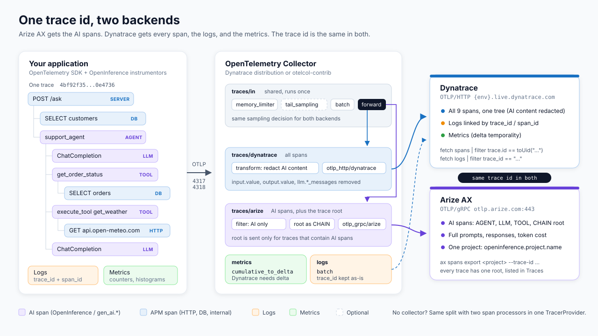
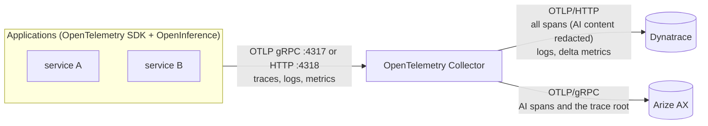
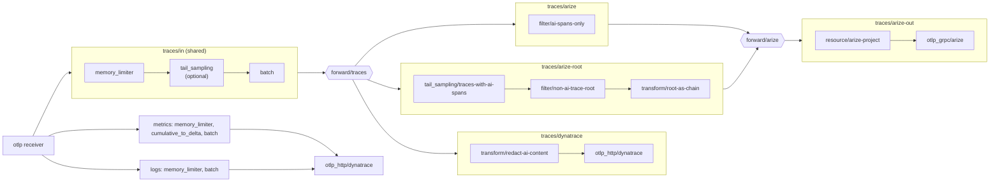

# Send telemetry to Arize AX and Dynatrace through an OpenTelemetry Collector

Applications send traces, logs, and metrics to one OTLP endpoint: the collector. The collector fans out:

- Dynatrace gets every span, every log, and every metric.
- Arize AX gets the AI spans (OpenInference or OTel GenAI semantic conventions), plus the trace's root span tagged as a CHAIN so the trace has a root in Arize.
- The trace id is the same in both, because the collector never rewrites trace or span ids.

The config is [`collector/config.yaml`](../collector/config.yaml). It works with the Dynatrace distribution of the collector (`dynatrace-otel-collector` 0.60.0) and with `otelcol-contrib` 0.165.0. See [TESTING.md](../TESTING.md) for how it was tested.



## Architecture



The application needs no Arize or Dynatrace credentials and no filtering code. It exports with the standard `OTEL_EXPORTER_OTLP_ENDPOINT=http://collector:4318`.

## Pipelines



| Pipeline | Receives | Processors | Exports to |
| --- | --- | --- | --- |
| `traces/in` | `otlp` | `memory_limiter`, (`tail_sampling`), `batch` | `forward/traces` |
| `traces/dynatrace` | `forward/traces` | `transform/redact-ai-content` | Dynatrace |
| `traces/arize` | `forward/traces` | `filter/ai-spans-only` | `forward/arize` |
| `traces/arize-root` | `forward/traces` | `tail_sampling/traces-with-ai-spans`, `filter/non-ai-trace-root`, `transform/root-as-chain` | `forward/arize` |
| `traces/arize-out` | `forward/arize` | `resource/arize-project` | Arize AX |
| `metrics` | `otlp` | `memory_limiter`, `cumulative_to_delta`, `batch` | Dynatrace |
| `logs` | `otlp` | `memory_limiter`, `batch` | Dynatrace |

## Design decisions

### Shared processing runs once, before the fan-out

Anything that decides which traces exist (memory limiting, sampling) belongs in `traces/in`. If each branch sampled on its own, Arize could keep a trace that Dynatrace dropped, and you could no longer look up a trace from one backend in the other. The branch pipelines only change what each backend sees of a trace: filter, redact, enrich.

### `forward` connector, not `routing`

The [`forward` connector](https://github.com/open-telemetry/opentelemetry-collector/blob/main/connector/forwardconnector/README.md) copies everything from `traces/in` into every pipeline that lists it as a receiver. It ships in both distributions. The `routing` connector is only in contrib, and it sends data to the first route that matches, while AI spans need to go to both backends. `forward` plus a filter in the Arize branch expresses "everything to Dynatrace, the AI subset to Arize" directly.

A second `forward` connector, `forward/arize`, joins the two Arize branches in front of a single exporter.

### Arize branch: which spans count as AI

```yaml
filter/ai-spans-only:
  error_mode: ignore
  trace_conditions:          # a span is dropped when the condition is true
    - >-
      span.attributes["openinference.span.kind"] == nil and
      span.attributes["gen_ai.operation.name"] == nil and
      span.attributes["gen_ai.request.model"] == nil and
      span.attributes["gen_ai.tool.name"] == nil
```

- Every OpenInference instrumentor sets `openinference.span.kind` (LLM, CHAIN, TOOL, AGENT, RETRIEVER, EMBEDDING, and so on).
- Spans that follow the OpenTelemetry GenAI semantic conventions (`gen_ai.*`) are kept too. Arize AX [ingests them natively](https://arize.com/docs/ax/concepts/otel-openinference/semantic-conventions) and derives the span kind from `gen_ai.operation.name`: `chat` becomes LLM, `execute_tool` becomes TOOL, `invoke_agent` becomes AGENT. OTTL can't test "any key starts with `gen_ai.`", so the filter checks the keys that the GenAI conventions require or that Arize uses to infer the kind.
- If two instrumentors emit spans for the same call (for example an OpenInference and an OTel GenAI instrumentor for the same OpenAI client), Arize shows both. Use one instrumentor per library.

### Every trace gets a root in Arize

Arize lists traces by their root span, the span with no parent. The top AI span of a request usually has an APM parent, such as the HTTP server span, and `filter/ai-spans-only` drops that parent. Without a fix, Arize stores the AI spans but has no root for the trace, so the trace is missing from the Traces view.

The `traces/arize-root` branch fixes this without app changes:

1. `tail_sampling/traces-with-ai-spans` waits `decision_wait` (30 s by default) after the first span of a trace and passes the trace on only if it contains an AI span. Requests without AI spans send nothing to Arize.
2. `filter/non-ai-trace-root` keeps only the span with no parent, and only if it is not already an AI span. AI roots take the `traces/arize` path, so nothing is sent twice.
3. `transform/root-as-chain` sets `openinference.span.kind = CHAIN` on that span.

```yaml
tail_sampling/traces-with-ai-spans:
  decision_wait: ${env:ARIZE_ROOT_DECISION_WAIT:-30s}
  num_traces: 50000
  decision_cache:
    sampled_cache_size: 100000
  policies:
    - name: has-ai-span
      type: ottl_condition
      ottl_condition:
        error_mode: ignore
        span:
          - attributes["openinference.span.kind"] != nil
          - attributes["gen_ai.operation.name"] != nil
          - attributes["gen_ai.request.model"] != nil
          - attributes["gen_ai.tool.name"] != nil

filter/non-ai-trace-root:
  error_mode: ignore
  trace_conditions:
    - span.parent_span_id != SpanID(0x0000000000000000)
    - span.attributes["openinference.span.kind"] != nil
    - span.attributes["gen_ai.operation.name"] != nil
    - span.attributes["gen_ai.request.model"] != nil
    - span.attributes["gen_ai.tool.name"] != nil

transform/root-as-chain:
  error_mode: ignore
  trace_statements:
    - set(span.attributes["openinference.span.kind"], "CHAIN")
```

The result in Arize is the request span as the root, with the AI spans under it at their real positions. Nested agents stay nested, because no parent ids are changed. The root span usually ends last and can arrive after `decision_wait`; `decision_cache` keeps the "send" decision for it. The AI spans themselves never pass through `tail_sampling`, so a missed decision can only cost the root, never AI data.

This works when the top AI span's parent is the trace root and all spans of a trace reach the same collector instance. If AI spans sit under other non-AI spans (for example a queue consumer span inside the request), or the trace root is exported by a service that doesn't use this collector, tag the span that encloses the AI work as a CHAIN in the app.

App-side tagging is still the better option when you can change the app, because it also puts the request input and output on the root:

```python
span = trace.get_current_span()            # the HTTP server span
span.set_attributes({"openinference.span.kind": "CHAIN", "input.value": question})
...
span.set_attribute("output.value", answer)
```

A tagged root passes `filter/ai-spans-only` directly, and `traces/arize-root` skips it. See `AI_ROOT=server` in [`example/app.py`](../example/app.py).

Clearing `parent_span_id` on AGENT spans with OTTL is not used here. It roots the trace for a single agent, but every nested agent becomes a separate root as well.

If you build your own collector, Arize's [filter-remap-processor](https://github.com/Arize-ai/filter-remap-processor) is an alternative to `filter/ai-spans-only` plus `traces/arize-root`: it buffers each trace, drops the non-AI spans, and points every kept span at its nearest kept ancestor, so AI spans under other non-AI spans stay connected. It is not part of the Dynatrace distribution or `otelcol-contrib`, so it needs a custom build with the OpenTelemetry Collector Builder, and the remapped spans then have different parent ids in Arize than in Dynatrace.

### Project name

`resource/arize-project` inserts `openinference.project.name` from `ARIZE_PROJECT_NAME` when the app didn't set it (`insert` never overwrites). For one collector that serves many AI apps, let each app set the resource attribute (`OTEL_RESOURCE_ATTRIBUTES=openinference.project.name=support-agent`) and keep the processor as a fallback. To route apps to different Arize spaces, see Arize's [header-based routing pattern](https://arize.com/docs/ax/instrument/advanced-patterns) (`headers_setter` extension, contrib only).

### Arize exporter: gRPC

```yaml
otlp_grpc/arize:
  endpoint: otlp.arize.com:443
  headers:
    space_id: ${env:ARIZE_SPACE_ID}
    api_key: ${env:ARIZE_API_KEY}
```

gRPC over TLS works with the collector's default gzip compression. If you must use HTTP (for example behind a proxy that blocks gRPC), turn compression off. The collector's `otlp_http` exporter gzips by default, and Arize's HTTP endpoint answers gzip bodies with `400 ... proto: cannot parse invalid wire-format data`.

```yaml
otlp_http/arize:
  endpoint: https://otlp.arize.com    # the exporter appends /v1/traces
  compression: none
  headers:
    space_id: ${env:ARIZE_SPACE_ID}
    api_key: ${env:ARIZE_API_KEY}
```

Arize also accepts `arize-space-id` and `arize-api-key` as header names.

### Dynatrace branch: all spans, content redacted

`transform/redact-ai-content` deletes prompt and completion attributes: `input.value`, `output.value`, `llm.input_messages.*`, `llm.output_messages.*`, `llm.prompts.*`, `llm.prompt_template.variables`, `gen_ai.input.messages`, `gen_ai.output.messages`, `gen_ai.system_instructions`, `gen_ai.tool.call.arguments`, and `gen_ai.tool.call.result`. AI spans still reach Dynatrace with model, token counts, tool name, status, and timings, so the Dynatrace trace is one tree with no gaps. To keep content in Dynatrace as well, remove the processor from `traces/dynatrace`. To keep AI spans out of Dynatrace entirely, see the tradeoffs in [in-code-instrumentation.md](in-code-instrumentation.md#should-ai-spans-go-to-dynatrace-too).

```yaml
otlp_http/dynatrace:
  endpoint: ${env:DYNATRACE_ENV_URL}/api/v2/otlp   # exporter appends /v1/traces, /v1/logs, /v1/metrics
  headers:
    Authorization: "${env:DYNATRACE_AUTH_SCHEME:-Bearer} ${env:DYNATRACE_API_TOKEN}"
```

Dynatrace's OTLP API accepts HTTP/protobuf only, not gRPC. Use `Bearer` with platform tokens (`dt0s16.*`, scopes `openpipeline:traces:ingest`, `openpipeline:logs:ingest`, `openpipeline:metrics:ingest`) and `Api-Token` with access tokens (`dt0c01.*`, scopes `openTelemetryTrace.ingest`, `logs.ingest`, `metrics.ingest`). Through an ActiveGate, the endpoint is `https://{activegate}:9999/e/{your-environment-id}/api/v2/otlp`.

### Metrics

```yaml
cumulative_to_delta:      # Dynatrace ingests delta metrics
  max_staleness: 15m
```

The processor converts cumulative counters and histograms; delta input passes through. It is stateful: it remembers the previous value of each series, so send a given metric stream to the same collector instance (an agent or sidecar collector, or one gateway replica per source). Alternatively, set delta temporality in the SDK (`OTEL_EXPORTER_OTLP_METRICS_TEMPORALITY_PREFERENCE=delta`) and the conversion does nothing. Keep `max_staleness` above your export interval.

### Logs

Logs pass through unchanged. The SDK puts the trace and span id on each record from the active context, and Dynatrace exposes them as `trace_id` and `span_id`. Don't also add a `trace_id` attribute in app code; Dynatrace then stores `trace_id` as an array and `filter trace_id == "..."` stops matching.

### Secrets, health, debugging

- Secrets come from the environment (`${env:ARIZE_API_KEY}`), and `${env:VAR:-default}` supplies defaults. Keep them in a Kubernetes Secret or an `.env` file, not in the YAML.
- `health_check` answers on `:13133/`. Self-metrics are on `:8888/metrics`, for example `otelcol_exporter_sent_spans{exporter="otlp_grpc/arize"}`, `otelcol_exporter_send_failed_spans`, `otelcol_processor_filter_spans_filtered`, and `otelcol_receiver_accepted_spans`.
- To print what each backend receives, add the debug overlay: `--config collector/config.yaml --config collector/debug.yaml`. Overlays replace lists, so the overlay restates the exporters lists.

### Sampling

Head sampling in the SDK (`OTEL_TRACES_SAMPLER=parentbased_traceidratio`) needs nothing in the collector. For tail sampling, add `tail_sampling` to `traces/in`, before the fan-out:

```yaml
processors:
  tail_sampling:
    decision_wait: 10s
    num_traces: 50000
    policies:
      - name: errors
        type: status_code
        status_code: { status_codes: [ERROR] }
      - name: slow
        type: latency
        latency: { threshold_ms: 5000 }
      - name: ai-traces          # keep every trace that has an AI span
        type: ottl_condition
        ottl_condition:
          error_mode: ignore
          span:
            - attributes["openinference.span.kind"] != nil
      - name: baseline
        type: probabilistic
        probabilistic: { sampling_percentage: 10 }
service:
  pipelines:
    traces/in:
      processors: [memory_limiter, tail_sampling, batch]
```

### Scaling

Two processors in this config keep state: `tail_sampling/traces-with-ai-spans` (and `tail_sampling` in `traces/in` if you add it) needs every span of a trace on the same instance, and `cumulative_to_delta` needs every point of a metric stream on the same instance. With one replica, or one collector per host or pod, nothing else is needed.

With several gateway replicas, put a first tier in front that routes spans by trace id with the `load_balancing` exporter (in both distributions) to a headless Service of gateways that run this config:

```yaml
exporters:
  load_balancing:
    routing_key: traceID
    protocol:
      otlp:
        tls: { insecure: true }
    resolver:
      dns:
        hostname: otel-gateway-headless.observability.svc.cluster.local
        port: "4317"
```

If you scale out without trace-id routing, AI spans still reach Arize. Only the root span can go missing for traces split across replicas.

`memory_limiter` comes first in every pipeline, so an overloaded collector refuses data instead of crashing.

## Which distribution

| | Dynatrace distribution | otelcol-contrib |
| --- | --- | --- |
| Components this config needs (`otlp` receiver, `memory_limiter`, `batch`, `filter`, `transform`, `resource`, `tail_sampling`, `cumulative_to_delta`, `forward`, `otlp_grpc`, `otlp_http`, `health_check`) | Included | Included |
| `load_balancing`, `debug` | Included | Included |
| `routing` connector, `headers_setter` extension | Not included | Included |
| Support | Supported by Dynatrace | Community |

Use the Dynatrace distribution unless you need a component it lacks.

## Run it

### Binary (no Docker)

```bash
cp .env.example .env              # fill in ARIZE_* and DYNATRACE_*
scripts/run-collector.sh          # downloads dynatrace-otel-collector into bin/ and runs it
DISTRO=contrib scripts/run-collector.sh
DEBUG=1 scripts/run-collector.sh  # also print exported spans
```

Or by hand:

```bash
set -a; source .env; set +a
./dynatrace-otel-collector validate --config collector/config.yaml
./dynatrace-otel-collector --config collector/config.yaml
```

Releases: [Dynatrace distribution](https://github.com/Dynatrace/dynatrace-otel-collector/releases), [otelcol-contrib](https://github.com/open-telemetry/opentelemetry-collector-releases/releases).

### Docker Compose

[`docker-compose.yaml`](../docker-compose.yaml) runs `ghcr.io/dynatrace/dynatrace-otel-collector/dynatrace-otel-collector:0.60.0` with the config mounted and `.env` as the environment:

```bash
docker compose up -d
curl -s localhost:13133/
```

### Kubernetes

A single gateway Deployment. Put credentials in a Secret and the config in a ConfigMap:

```bash
kubectl create namespace observability
kubectl -n observability create secret generic otel-backends \
  --from-literal=ARIZE_SPACE_ID=... --from-literal=ARIZE_API_KEY=... \
  --from-literal=DYNATRACE_ENV_URL=https://{your-environment-id}.live.dynatrace.com \
  --from-literal=DYNATRACE_API_TOKEN=... --from-literal=DYNATRACE_AUTH_SCHEME=Bearer \
  --from-literal=ARIZE_PROJECT_NAME=my-ai-app
kubectl -n observability create configmap otel-gateway --from-file=config.yaml=collector/config.yaml
```

```yaml
apiVersion: apps/v1
kind: Deployment
metadata: { name: otel-gateway, namespace: observability }
spec:
  replicas: 1            # more than 1 needs a load_balancing tier in front (see Scaling)
  selector: { matchLabels: { app: otel-gateway } }
  template:
    metadata: { labels: { app: otel-gateway } }
    spec:
      containers:
        - name: collector
          image: ghcr.io/dynatrace/dynatrace-otel-collector/dynatrace-otel-collector:0.60.0
          args: ["--config=/conf/config.yaml"]
          envFrom: [{ secretRef: { name: otel-backends } }]
          ports:
            - { name: otlp-grpc, containerPort: 4317 }
            - { name: otlp-http, containerPort: 4318 }
          readinessProbe: { httpGet: { path: /, port: 13133 } }
          livenessProbe: { httpGet: { path: /, port: 13133 } }
          resources:
            requests: { cpu: 200m, memory: 256Mi }
            limits: { memory: 1Gi }
          volumeMounts: [{ name: conf, mountPath: /conf }]
      volumes: [{ name: conf, configMap: { name: otel-gateway } }]
---
apiVersion: v1
kind: Service
metadata: { name: otel-gateway, namespace: observability }
spec:
  selector: { app: otel-gateway }
  ports:
    - { name: otlp-grpc, port: 4317 }
    - { name: otlp-http, port: 4318 }
```

Applications then set `OTEL_EXPORTER_OTLP_ENDPOINT=http://otel-gateway.observability:4318`. Dynatrace also publishes [Helm and Operator setups](https://docs.dynatrace.com/docs/ingest-from/opentelemetry/collector/deployment) for its distribution, and the same `config.yaml` works with those.

## Point the application at the collector

```bash
OTEL_EXPORTER_OTLP_ENDPOINT=http://localhost:4318
OTEL_EXPORTER_OTLP_PROTOCOL=http/protobuf
OTEL_SERVICE_NAME=support-api
OTEL_RESOURCE_ATTRIBUTES=openinference.project.name=support-agent   # optional
```

Use one `TracerProvider` with one OTLP exporter, a `LoggerProvider`, and a `MeterProvider`, all pointed at the collector ([`example/telemetry.py`](../example/telemetry.py), `collector` mode). The trace id rules from the in-code guide still apply: one provider per process, `traceparent` between services, and no hand-written `trace_id` log attributes.

## Verify

```bash
scripts/verify.py collector collector-nochain collector-nested
COLLECTOR_BIN=otelcol-contrib scripts/verify.py collector
```

Each scenario sends one request through a collector started from `bin/`, then checks Arize, Dynatrace, and the collector's self-metrics. [TESTING.md](../TESTING.md) lists every check.

To find a trace in Dynatrace by hand, open it in the Distributed Tracing app or run this in a notebook:

```text
fetch spans | filter trace.id == toUid("<trace id>")
```
