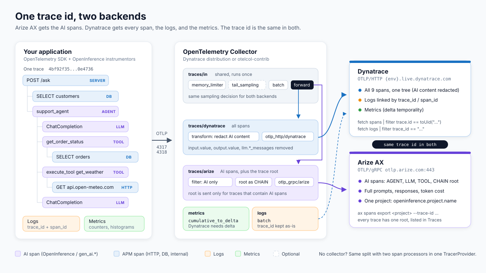
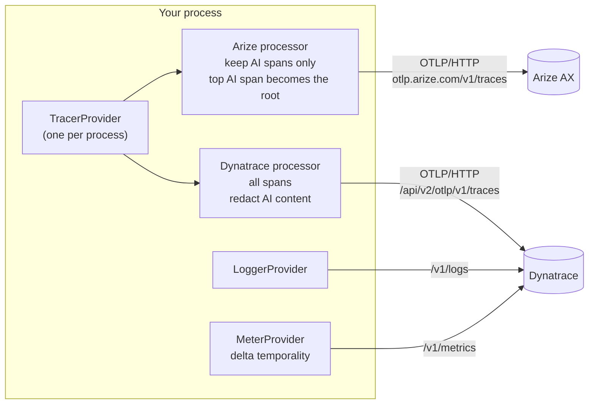
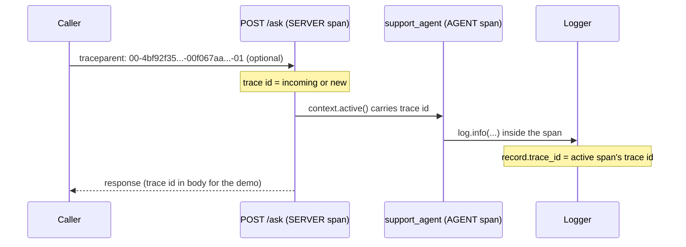

# Send telemetry to Arize AX and Dynatrace from application code

This guide shows how to export from one application, with no collector, so that:

- Arize AX receives the AI spans: agents, LLM calls, tools, retrievers.
- Dynatrace receives every span (HTTP, database, internal, and AI), plus logs and metrics.
- Both show the same trace id, so you can take a bad answer in Arize and find the slow query or failing dependency for that request in Dynatrace.

If you run, or can run, an OpenTelemetry Collector, read [collector.md](collector.md) instead. The README has a [decision guide](../README.md#which-approach).



## How it works



There is one `TracerProvider` with two span processors. Each processor sees every span that ends and decides what to forward:

| Signal | Arize AX | Dynatrace |
| --- | --- | --- |
| AI spans (`openinference.span.kind` or `gen_ai.*`) | Yes, with prompts and responses | Yes, prompts and responses removed (configurable) |
| HTTP server and client, database, internal spans | No | Yes |
| Logs | No | Yes, with `trace_id` and `span_id` |
| Metrics | No | Yes, delta temporality |

### Why the trace id matches

The trace id is generated once, when the root span starts, or taken from an incoming `traceparent` header. Every child span inherits it from the active context. Both processors export the same spans, so the ids are identical. Nothing has to copy or translate an id.

Logs get the same id the same way. The OpenTelemetry log bridge (Python `LoggingHandler`, Node `logger.emit({ context })`) reads the active span context when the record is emitted and fills the record's `trace_id` and `span_id` fields. Dynatrace shows them as the `trace_id` and `span_id` log attributes.



Two rules keep the ids in sync:

1. Use one provider per process. Two `TracerProvider`s (for example one from `arize.otel.register()` and one for Dynatrace) produce two separate traces for the same request. If you already call `register()`, read the note at the end of the Python section.
2. Don't set `trace_id` as a log attribute yourself. The SDK already sends it as a top-level field. If you add it again, Dynatrace stores `trace_id` as an array and `filter trace_id == "..."` stops matching.

### Across services

Propagate the W3C Trace Context header (`traceparent`, plus `baggage` if you use it) on every hop. The default propagator in the OpenTelemetry SDKs is `tracecontext,baggage`, and HTTP client and server instrumentations inject and extract it. Each service exports with its own two processors, and Arize and Dynatrace join the spans into one trace by id.

Dynatrace OneAgent also reads and writes `traceparent`, so services monitored by OneAgent and services instrumented with OpenTelemetry join the same trace. If OneAgent monitors the same process that runs this SDK setup, check the OneAgent OpenTelemetry settings so spans are not captured twice.

### Every trace gets a root in Arize

Arize lists traces by their root span, the span with no parent. The Arize processor drops APM spans, so the top AI span would point at a parent (usually the HTTP server span) that Arize never receives, and the trace would be missing from the Traces view.

The Arize processors in this guide handle this by default. When an AI span's local parent is a non-AI span, the Arize processor exports that AI span without a parent, so it becomes the root in Arize. The change applies only to the copy the Arize processor sees: Dynatrace keeps the real parent and one complete tree. AI spans under other AI spans keep their parents, so nested agents stay nested.

A parent that comes from another service (a remote `traceparent`) is kept, because the upstream service may export its own AI spans to Arize under the same trace.

## Python

Tested with Python 3.13, `opentelemetry-sdk` 1.45.2, `openinference-instrumentation-openai` 0.1.69, and `openai` 3.48. Full code: [`example/telemetry.py`](../example/telemetry.py) and [`example/openinference_processors.py`](../example/openinference_processors.py).

```bash
pip install opentelemetry-sdk opentelemetry-exporter-otlp-proto-http \
  openinference-instrumentation-openai openai
```

### 1. The Arize processor

The Python OpenInference packages don't include a span filter or a root processor, so the kit has a small one. It keeps spans that have `openinference.span.kind` or any `gen_ai.*` attribute, and it makes the top AI span the root. Arize [normalizes OTel GenAI spans](https://arize.com/docs/ax/concepts/otel-openinference/semantic-conventions) into OpenInference at ingestion, so a span with only `gen_ai.*` attributes, such as `gen_ai.operation.name = execute_tool`, arrives as a TOOL span.

```python
from opentelemetry import trace
from opentelemetry.sdk.trace import ReadableSpan, SpanProcessor


def is_ai_span(span) -> bool:
    attributes = span.attributes or {}
    return "openinference.span.kind" in attributes or any(k.startswith("gen_ai.") for k in attributes)


class OpenInferenceSpanProcessor(SpanProcessor):
    """Forwards AI spans to `delegate`. AI spans whose local parent is a non-AI span
    are forwarded without a parent, so they are trace roots in Arize."""

    def __init__(self, delegate, *, span_filter=is_ai_span, reparent_orphans=True):
        self._delegate, self._filter, self._reparent = delegate, span_filter, reparent_orphans
        self._orphans: set[int] = set()

    def on_start(self, span, parent_context=None):
        parent = trace.get_current_span(parent_context)
        if self._reparent and isinstance(parent, ReadableSpan) and not self._filter(parent):
            self._orphans.add(span.context.span_id)
        self._delegate.on_start(span, parent_context)

    def on_end(self, span):
        orphan = span.context.span_id in self._orphans
        self._orphans.discard(span.context.span_id)
        if self._filter(span):
            # A copy: the same span object also goes to the Dynatrace processor.
            self._delegate.on_end(_copy(span, parent=None) if orphan else span)

    def shutdown(self):
        self._delegate.shutdown()

    def force_flush(self, timeout_millis=30000):
        return self._delegate.force_flush(timeout_millis)
```

`_copy` builds a new `ReadableSpan` with the same fields (see the full file). Don't mutate the span in a processor: every processor on the provider receives the same object.

The decision uses the parent's attributes when the child starts. If you tag a parent as an AI span later in its lifetime, its children have already been classified.

### 2. Wire up traces, logs, and metrics

```python
import logging, os
from opentelemetry import metrics, trace
from opentelemetry._logs import set_logger_provider
from opentelemetry.exporter.otlp.proto.http._log_exporter import OTLPLogExporter
from opentelemetry.exporter.otlp.proto.http.metric_exporter import OTLPMetricExporter
from opentelemetry.exporter.otlp.proto.http.trace_exporter import OTLPSpanExporter
from opentelemetry.sdk._logs import LoggerProvider, LoggingHandler
from opentelemetry.sdk._logs.export import BatchLogRecordProcessor
from opentelemetry.sdk.metrics import Counter, Histogram, MeterProvider, ObservableCounter
from opentelemetry.sdk.metrics.export import AggregationTemporality, PeriodicExportingMetricReader
from opentelemetry.sdk.resources import Resource
from opentelemetry.sdk.trace import TracerProvider
from opentelemetry.sdk.trace.export import BatchSpanProcessor
from openinference.instrumentation.openai import OpenAIInstrumentor

from openinference_processors import ContentRedactingExporter, OpenInferenceSpanProcessor

resource = Resource.create({
    "service.name": "support-api",
    "openinference.project.name": "support-agent",   # Arize project
})

dt_base = os.environ["DYNATRACE_ENV_URL"].rstrip("/") + "/api/v2/otlp"
token = os.environ["DYNATRACE_API_TOKEN"]
dt_headers = {"Authorization": ("Api-Token " if token.startswith("dt0c") else "Bearer ") + token}

provider = TracerProvider(resource=resource)
provider.add_span_processor(OpenInferenceSpanProcessor(BatchSpanProcessor(OTLPSpanExporter(
    endpoint="https://otlp.arize.com/v1/traces",
    headers={"space_id": os.environ["ARIZE_SPACE_ID"], "api_key": os.environ["ARIZE_API_KEY"]},
))))
provider.add_span_processor(BatchSpanProcessor(ContentRedactingExporter(
    OTLPSpanExporter(endpoint=f"{dt_base}/v1/traces", headers=dt_headers)
)))
trace.set_tracer_provider(provider)

logger_provider = LoggerProvider(resource=resource)
logger_provider.add_log_record_processor(
    BatchLogRecordProcessor(OTLPLogExporter(endpoint=f"{dt_base}/v1/logs", headers=dt_headers)))
set_logger_provider(logger_provider)
logging.getLogger("support").addHandler(LoggingHandler(logger_provider=logger_provider))

# Dynatrace ingests delta metrics.
delta = {Counter: AggregationTemporality.DELTA, ObservableCounter: AggregationTemporality.DELTA,
         Histogram: AggregationTemporality.DELTA}
metrics.set_meter_provider(MeterProvider(resource=resource, metric_readers=[PeriodicExportingMetricReader(
    OTLPMetricExporter(endpoint=f"{dt_base}/v1/metrics", headers=dt_headers, preferred_temporality=delta))]))

OpenAIInstrumentor().instrument(tracer_provider=provider)
```

Then add your usual HTTP and database instrumentation (`FastAPIInstrumentor`, `SQLite3Instrumentor`, `HTTPXClientInstrumentor`, and so on) on the same provider. Attach the `LoggingHandler` to your application loggers, not the root logger, unless you also want library and exporter logs in Dynatrace.

If you use `arize.otel.register()`, keep it as the only provider. `register(project_name=..., span_processors=[...])` runs the extra processors you pass, but its own Arize exporter receives every span, including APM spans. To keep APM spans out of Arize, build the provider as shown above.

## TypeScript and Node.js (Vercel AI SDK)

Tested with Node 23, `ai` 7.0, `@ai-sdk/otel` 1.0, `@arizeai/openinference-vercel` 3.3.1, and `@opentelemetry/sdk-trace-node` 2.12. Full code: [`example-ts/index.ts`](../example-ts/index.ts) and [`example-ts/arize-root-processor.ts`](../example-ts/arize-root-processor.ts). On Vercel, `@vercel/otel`'s `registerOTel({ spanProcessors, logRecordProcessors, metricReaders })` takes the same processors and readers.

`ArizeRootProcessor` wraps the Arize processor and does what the Python processor above does: AI spans whose local parent is a non-AI span reach Arize without a parent.

```ts
import { registerTelemetry } from "ai";
import { OpenTelemetry } from "@ai-sdk/otel";
import { enrichSpanWithOpenInference, isOpenInferenceSpan, OpenInferenceBatchSpanProcessor } from "@arizeai/openinference-vercel";
import { SEMRESATTRS_PROJECT_NAME } from "@arizeai/openinference-semantic-conventions";
import { OTLPTraceExporter } from "@opentelemetry/exporter-trace-otlp-proto";
import { OTLPLogExporter } from "@opentelemetry/exporter-logs-otlp-proto";
import { OTLPMetricExporter } from "@opentelemetry/exporter-metrics-otlp-proto";
import { AggregationTemporalityPreference } from "@opentelemetry/exporter-metrics-otlp-http";
import { resourceFromAttributes } from "@opentelemetry/resources";
import { BatchLogRecordProcessor, LoggerProvider } from "@opentelemetry/sdk-logs";
import { MeterProvider, PeriodicExportingMetricReader } from "@opentelemetry/sdk-metrics";
import { BatchSpanProcessor } from "@opentelemetry/sdk-trace-base";
import { NodeTracerProvider } from "@opentelemetry/sdk-trace-node";
import { ArizeRootProcessor } from "./arize-root-processor";

registerTelemetry(new OpenTelemetry({ enrichSpan: enrichSpanWithOpenInference })); // AI SDK v7

const dtBase = `${process.env.DYNATRACE_ENV_URL}/api/v2/otlp`;
const token = process.env.DYNATRACE_API_TOKEN!;
const dtHeaders = { Authorization: `${token.startsWith("dt0c") ? "Api-Token" : "Bearer"} ${token}` };
const resource = resourceFromAttributes({ "service.name": "support-api", [SEMRESATTRS_PROJECT_NAME]: "support-agent" });

const tracerProvider = new NodeTracerProvider({
  resource,
  spanProcessors: [
    new ArizeRootProcessor(
      new OpenInferenceBatchSpanProcessor({
        exporter: new OTLPTraceExporter({
          url: "https://otlp.arize.com/v1/traces",
          headers: { space_id: process.env.ARIZE_SPACE_ID!, api_key: process.env.ARIZE_API_KEY! },
        }),
        spanFilter: isOpenInferenceSpan,
      }),
    ),
    new BatchSpanProcessor(redactAiContent(new OTLPTraceExporter({ url: `${dtBase}/v1/traces`, headers: dtHeaders }))),
  ],
});
tracerProvider.register();

const loggerProvider = new LoggerProvider({
  resource,
  processors: [new BatchLogRecordProcessor({ exporter: new OTLPLogExporter({ url: `${dtBase}/v1/logs`, headers: dtHeaders }) })],
});
const meterProvider = new MeterProvider({
  resource,
  readers: [new PeriodicExportingMetricReader({
    // Dynatrace ingests delta metrics.
    exporter: new OTLPMetricExporter({ url: `${dtBase}/v1/metrics`, headers: dtHeaders,
      temporalityPreference: AggregationTemporalityPreference.DELTA }),
  })],
});
```

Each AI SDK call needs `experimental_telemetry: { isEnabled: true }`.

`redactAiContent` (in the full file) wraps each span with `Object.create(span, { attributes: { value: kept } })`. That gives the Dynatrace exporter a new attributes object without touching the span the Arize processor also holds.

## Should AI spans go to Dynatrace too?

| Option | What Dynatrace gets | Pros | Cons |
| --- | --- | --- | --- |
| A. AI spans, content removed (default in this kit) | Every span; AI spans keep model, token counts, tool names, timings, status | One complete trace tree in Dynatrace; LLM and tool latency next to the database and HTTP spans; no second copy of prompts | Some extra span volume |
| B. AI spans with content | Everything | No redaction step | Prompts and responses, which often contain personal data, are stored twice; larger spans; more ingest cost |
| C. No AI spans | APM spans only | Least volume; no AI data in Dynatrace | Gaps in the tree: APM spans under AI spans (the SQL a tool runs) have a parent Dynatrace never receives, so you need a processor that reparents them onto the request span |

We recommend A. Arize is the system of record for AI content, since evaluations, annotations, and prompt review need it there. Dynatrace shows where the time went for the same request. Removed attributes: `input.value`, `output.value`, `llm.input_messages.*`, `llm.output_messages.*`, `llm.prompts.*`, `llm.prompt_template.variables`, `gen_ai.input.messages`, `gen_ai.output.messages`, `gen_ai.system_instructions`, `gen_ai.tool.call.arguments`, `gen_ai.tool.call.result`, and the AI SDK's `ai.prompt*` and `ai.response.text`.

## Sampling

Decide once, at the head, in the one provider. The sampler runs before either processor sees the span, so both backends get the same traces:

```bash
OTEL_TRACES_SAMPLER=parentbased_traceidratio
OTEL_TRACES_SAMPLER_ARG=0.25
```

Don't sample in one processor and not the other, or Arize will hold AI spans for traces Dynatrace never saw. For tail sampling (keep errors, slow requests), use the collector ([collector.md](collector.md#sampling)). Logs and metrics are not sampled.

## Flushing (serverless, scripts, short jobs)

Batch processors export on a timer, so a process or function that ends first loses the last batch. Call `force_flush()` on the tracer, logger, and meter providers, or `shutdown()` at exit, before returning. In a serverless function, collect the `forceFlush()` promises of every provider into one helper and await it at the end of each request; in a Python script, `shutdown()` at exit is enough.

## Endpoints and authentication

| Backend | Signal | Endpoint | Headers |
| --- | --- | --- | --- |
| Arize AX | traces, OTLP/HTTP protobuf | `https://otlp.arize.com/v1/traces` | `space_id`, `api_key` (`arize-space-id`, `arize-api-key` also work) |
| Arize AX | traces, OTLP/gRPC | `otlp.arize.com:443` (TLS) | same |
| Dynatrace SaaS | traces, logs, metrics; OTLP/HTTP protobuf only | `https://{your-environment-id}.live.dynatrace.com/api/v2/otlp/v1/{traces,logs,metrics}` | `Authorization: Api-Token dt0c01...` (access token) or `Authorization: Bearer dt0s16...` (platform token) |
| Dynatrace through ActiveGate | same | `https://{activegate}:9999/e/{your-environment-id}/api/v2/otlp/v1/...` | same |

Token scopes for ingest: access tokens need `openTelemetryTrace.ingest`, `logs.ingest`, and `metrics.ingest`; platform tokens need `openpipeline:traces:ingest`, `openpipeline:logs:ingest`, and `openpipeline:metrics:ingest`.

Don't gzip requests to Arize's HTTP endpoint; it answers gzip bodies with `400 proto: cannot parse invalid wire-format data`. The Python and Node HTTP exporters don't compress by default. gRPC with gzip works.

## Project naming

Arize groups spans by the resource attribute `openinference.project.name` (Python: `openinference.semconv.resource.ResourceAttributes.PROJECT_NAME`; JS: `SEMRESATTRS_PROJECT_NAME`). Set it once on the resource. Without it, spans land in the `default` project. Dynatrace ignores it.

## Pitfalls

| Symptom | Cause | Fix |
| --- | --- | --- |
| Dynatrace shows two roots for one request (the request span and a detached AI subtree) | `reparentOrphanedSpans: true` in `@arizeai/openinference-vercel` clears the parent on the shared span, so every processor sees the change | Use `ArizeRootProcessor`, which changes only Arize's copy. `reparentOrphanedSpans` is fine when Arize is the only backend that receives AI spans |
| AI trace missing from the Arize Traces view, but its spans exist | The top AI span's parent was dropped and nothing made it a root | Wrap the Arize processor in `OpenInferenceSpanProcessor` (Python) or `ArizeRootProcessor` (TS) |
| `filter trace_id == "..."` misses logs; `trace_id` is an array | The app set a `trace_id` log attribute in addition to the SDK's field | Remove the manual attribute |
| Different trace ids in Arize and Dynatrace | Two `TracerProvider`s, or work started outside the request context (threads, queues) without passing context | One provider; pass `context` into threads and tasks; propagate `traceparent` between services |
| Arize `400` from the HTTP endpoint | gzip compression | Turn compression off, or use gRPC |
| Dynatrace `401` or `403` | Wrong scheme (`Api-Token` or `Bearer`) or a missing ingest scope | Match the scheme to the token type; add the scopes above |
| No database spans from sqlite3 | `Connection.execute()` bypasses the instrumented cursor | Use `connection.cursor().execute()` |
| Last spans of a run never arrive | The process exited before the batch was exported | `force_flush()` or `shutdown()` before exit |

## Verify

```bash
scripts/verify.py incode incode-nested   # Python
scripts/verify.py incode-ts              # Node
```

The script sends one request, then checks Arize (`ax spans export`, `ax traces list`) and Dynatrace (Grail query API). [TESTING.md](../TESTING.md) lists every check. The equivalent DQL, for a notebook:

```text
fetch logs, from: now()-30m | filter trace_id == "<trace id>" | sort timestamp asc
fetch spans, from: now()-30m | filter trace.id == toUid("<trace id>")
timeseries sum(example.requests), from: now()-30m, filter: service.name == "ax-dt-example"
```

You can also open the trace id in the Dynatrace Distributed Tracing app.
